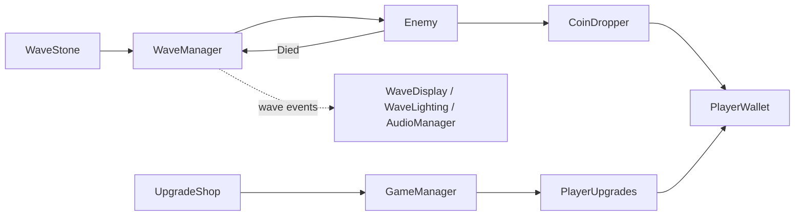

# Last Light

<!-- Play in the browser: https://<your-itch-username>.itch.io/last-light -->
<!--  -->

A small 2D wave-survival platformer I made in Unity 6.

It started as the TileVania project from the GameDev.tv Unity 2D course. After the course I kept working on it and turned it into a different game: you defend a village at night against waves of zombies, slimes and ghosts, and spend the coins they drop on upgrades between waves.

## How it plays

You start a wave by touching the magic stone. The sky gets darker, the music changes and enemies start coming in from the edges of the map. When the last one dies the light comes back, the leftover coins fly to you and you can visit the two shops:

- the statue sells max health, move speed, a dodge and healing
- the anvil sells fire rate, damage and multi-shot

There is no level cap, but prices go up every time you buy something. Waves keep getting bigger and enemies get more health, damage and speed, so every run ends at some point. Some enemies spawn as red elites with more health and more coins. Your ten best runs are saved locally.

## Controls

| Action | Key |
|---|---|
| Move | A / D |
| Jump | Space |
| Aim and shoot | Mouse |
| Start wave / open shop | E |
| Dodge (after buying it) | Shift |
| Pause | Esc or P |

## Code

Most of my time on this project went into the code structure, so a few notes:

- The player is split into small components (movement, aiming, shooting, health, wallet, upgrades) instead of one big Player script.
- Systems talk through C# events. For example `WaveManager` raises `WaveStarted` and `WaveCompleted`, and the wave text, the lighting and the music listen to them. The wave manager doesn't know any of them exist.
- Wave difficulty, the enemy spawn table, upgrades and shop contents are ScriptableObjects, so balancing doesn't need code changes. Each upgrade type is a small subclass of `UpgradeDefinition`.
- Enemies share one `Enemy` and `Health` component and only differ in their movement, which is behind an `IEnemyMovement` interface (walking, jumping and flying). The stone and the shops use an `IInteractable` interface.
- There are no singletons or `Find` calls. Scene objects are linked in the Inspector and spawned enemies get what they need through an `Initialize` method.
- Menus and shop windows are built from code at runtime.

Scripts are in `Assets/Scripts`, grouped by feature, and the tunable data is in `Assets/Data`.

## Running it

Open the project with Unity 6000.3 and open `Assets/Scenes/Level1.unity`.

The art and audio packs are not included in this repository because their licenses don't allow redistribution. To run the project you need to download them (links below) and put them in `Assets/ThirdParty/`.

## Credits

- Village props and tiles: [Cainos](https://cainos.itch.io/pixel-art-platformer-village-props)
- Background: [GandalfHardcore](https://gandalfhardcore.itch.io/)
- Characters, enemies, UI sprites, music and sound effects: [Undead Survivor Assets Pack by Goldmetal](https://assetstore.unity.com/packages/2d/undead-survivor-assets-pack-238068)
- Font: [Pixelify Sans](https://fonts.google.com/specimen/Pixelify+Sans) (SIL Open Font License)
- Some sprites from the GameDev.tv course
- Coin sound from [Pixabay](https://pixabay.com/)
