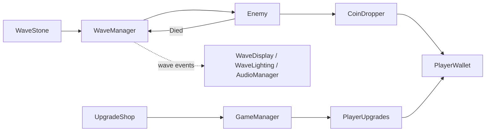

# Last Light

**[Play in the browser on itch.io](https://brahimux.itch.io/lastlight)**

A small 2D wave-survival platformer I made in Unity 6.

It started as the TileVania project from the GameDev.tv Unity 2D course. After the course I kept working on it and turned it into a different game: you defend a village at night against waves of zombies, slimes and ghosts, and spend the coins they drop on upgrades between waves.

## How it plays

You start a wave by touching the magic stone. The sky gets darker, the music changes and enemies start coming in from the edges of the map. When the last one dies the light comes back, the leftover coins fly to you and you can visit the two shops:

- the statue sells max health, move speed, a dodge and healing
- the anvil sells fire rate, damage and multi-shot

There is no level cap, but prices go up every time you buy something. Waves keep getting bigger and enemies get more health, damage and speed, so every run ends at some point. Some enemies spawn as red elites with more health and more coins. Your ten best runs are saved locally.

## Screenshots

  

## Controls

| Action | Key |
|---|---|
| Move | A / D |
| Jump | Space |
| Aim and shoot | Mouse |
| Start wave / open shop | E |
| Dodge (after buying it) | Shift |
| Pause | Esc or P |

## Unity side

- The level is built with Tilemaps and a Rule Tile. The ground uses a Tilemap Collider merged into a Composite Collider, so it is one collider instead of hundreds of small boxes.
- The camera is Cinemachine 2 (a State-Driven Camera with a Confiner 2D, so it never shows outside the map).
- Day and night is done with URP 2D lighting: `WaveLighting` fades a Global Light 2D when a wave starts or ends.
- Input uses the new Input System with two action maps, one for playing and one for menus. The game switches between them when a menu opens.
- Player and enemies are animated with Animators, and parameters are cached as hashes instead of strings.
- The background is made of parallax layers.
- Music crossfades between two audio sources (one track before waves, one during). The volume setting and the high score table are saved with PlayerPrefs, the high scores as JSON.
- It is built for WebGL and runs in the browser on itch.io.

## Code

Most of my time on this project went into the code structure. The patterns I used and where:

| Pattern | Where |
|---|---|
| Component-based design | The player is split into small components (movement, aiming, shooting, health, wallet, upgrades) instead of one big Player script. |
| Observer (C# events) | `WaveManager` raises `WaveStarted` and `WaveCompleted`. The wave text, lighting and music listen to them, and the wave manager doesn't know they exist. |
| Strategy | Each upgrade is a small subclass of `UpgradeDefinition`. Enemies share one `Enemy` component and only swap their movement through `IEnemyMovement` (walk, jump, fly). |
| State machine | Game flow (`GameState`: menu, playing, shopping, paused, game over), waves (preparing / in wave) and the slime's jump. |
| Template method | `BetweenWavesInteractable` handles the shared logic for the stone and the shops; each one only implements `OnInteract`. |
| Data-driven design | Wave difficulty, the enemy spawn table, upgrades and shop contents are ScriptableObjects, so balancing needs no code changes. |
| Dependency injection | No singletons or `Find` calls. Scene objects are linked in the Inspector, spawned enemies get what they need through `Initialize`. |
| Factory | `UIFactory` builds the menus and shop windows from code at runtime. |

Scripts are in `Assets/Scripts`, grouped by feature, and the tunable data is in `Assets/Data`.

## Running it

Open the project with Unity 6000.3 and open `Assets/Scenes/Level1.unity`.

The art and audio packs are not included in this repository because their licenses don't allow redistribution. To run the project you need to download them (links below) and put them in `Assets/ThirdParty/`.

## Credits

- Village props and tiles: [Cainos](https://cainos.itch.io/pixel-art-platformer-village-props)
- Background: [GandalfHardcore](https://gandalfhardcore.itch.io/)
- Characters, enemies, UI sprites, music and sound effects: [Undead Survivor Assets Pack by Goldmetal](https://assetstore.unity.com/packages/2d/undead-survivor-assets-pack-238068)
- Font: [Pixelify Sans](https://fonts.google.com/specimen/Pixelify+Sans) (SIL Open Font License)
- Some sprites from the GameDev.tv course
